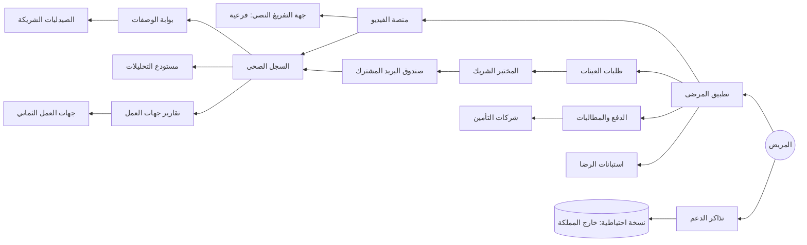

# خريطة التدفق المرجعية لقُرب (نقطة بداية المختبر 2.2)

هذه الخريطة هي الحل المرجعي للمختبر 2.1. ابدأ منها في المختبر 2.2 ولو لم تكمل خريطتك.
تُفتح الشيفرة أدناه في محرر Mermaid أو تُرسم يدويًا في diagrams.net.

| النشاط | الأنظمة | المستلمون خارج قُرب | الدولة |
|---|---|---|---|
| A1 | SY01 | لا يوجد | داخل المملكة |
| A2 | SY01، SY02 | جهة التفريغ النصي (فرعية) | داخل المملكة |
| A3 | SY03 | مورد السجل (جهة معالجة) | داخل المملكة |
| A4 | SY03، SY04 | الصيدليات الشريكة | داخل المملكة |
| A5 | SY05، SY11، SY03 | المختبر الشريك، شركة توصيل العينات | داخل المملكة |
| A6 | SY06 | بوابة الدفع، شركات التأمين | داخل المملكة |
| A7 | SY07 | خدمة التذاكر | داخل المملكة، ونسخة احتياطية خارجها |
| A8 | SY03، SY09 | جهات العمل الثماني | داخل المملكة |
| A9 | SY03، SY08 | لا يوجد | داخل المملكة |
| A10 | SY10 | أداة الاستبانات | داخل المملكة |

التدفقات الأربعة التي تحتاج قرارًا: F1 النسخة الاحتياطية خارج المملكة، F2 أسباب الزيارة إلى جهات العمل، F3 جهة
التفريغ النصي غير المذكورة، F4 صندوق البريد المشترك.
